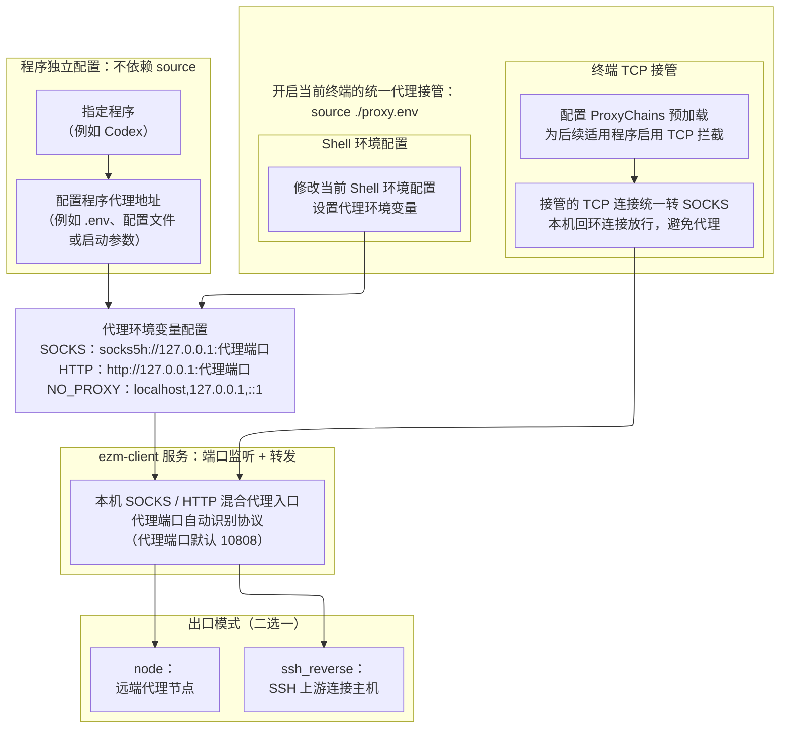

# ezm-client：ez-mihomo 客户端

> **⚠️ Agent 操作警告：不要切断当前会话正在使用的代理**
>
> 执行 `stop`、`restart` 之前，先确认当前 Agent 会话及其他任务是否通过本项目的 SOCKS 或 HTTP 入口联网。连接可能中断；**当前会话依赖该端口或无法确认时，不要在本会话中执行这些操作**。`status`、`test` 只能检查代理本身，不能证明当前会话没有使用它。

---

本项目由同一个 mihomo 进程在 `127.0.0.1` 提供 SOCKS / HTTP 混合代理入口，同一端口自动识别协议，使用当前选定出口。项目自带 mihomo 1.19.33，仅支持 Linux x86_64。流量从当前节点或 SSH 反向转发上游发出，不配置分流；`ping` 不走此代理。

如需快速部署使用，可直接跳到[迁移与部署](#6-迁移与部署)。

## 1 基本配置

### 1.1 当前模式与线路

出口模式写在 `config/mode.activate`，可选 `node`（节点代理）或 `ssh_reverse`（SSH 反向代理）；同一时间只运行一种模式。文件缺失或为空时，启动默认使用并写入 `node`；非法模式名报错。使用 `mode` 选择模式，使用 `protocol` 选择节点协议；两个命令只保存选择，不启停服务。服务未运行时执行 `start`，运行中执行 `restart` 应用修改。

节点模式的当前线路写在 `config/protocol.activate`，可选 `vless`、`vmess`、`hysteria2`、`trojan`、`shadowsocks`、`tuic`、`anytls`；同一时间只运行一条。文件缺失或为空时，启动默认使用并写入 `hysteria2`；非法线路名报错，不自动换线路。选择线路使用 `protocol`；修改后，执行 `restart` 生效。SSH 反向代理模式不使用节点链接，也不改变保存的节点协议。

### 1.2 节点链接

节点链接保存在 `config/links/` 下对应线路的 `.link` 文件中。当前线路的链接改完后，需执行 `restart` 才会生效；其他线路的链接在选择该线路并启动或重启后生效。节点模式下，链接为空、解析失败或核心配置校验失败时，服务仍会监听本机端口，但拒绝转发外部连接。不存在的链接文件会在启动时建成空文件，不会自动填入节点。

### 1.3 本机端口

统一代理端口写在 `config/ports/listening.port`，填写一个 `1–65535` 的整数，默认 `10808`，SOCKS 和 HTTP 共用。新启动服务或执行 `source` 时会检查端口配置：文件缺失、为空或内容无效，就使用默认端口并写回文件，写入时自动创建缺失的目录。修改端口后，重启代理并重新 `source`；单独配置代理地址的程序也需更新端口。

### 1.4 SSH 反向代理

`ssh_reverse` 模式通过 SSH 反向隧道使用另一端的网络出网。**本机**指运行 ezm-client 的机器；**SSH 上游连接主机**指主动向本机发起 SSH 连接的机器，例如运行 VS Code / Cursor 并连接本机的电脑。可使用该主机上的代理，也可直接使用该主机的网络。

**端口配置**

| 位置 | 配置或端口 | 用途 |
|---|---|---|
| 本机 | `config/ports/listening.port`，默认 `10808` | 本机程序使用的 ezm-client 混合代理入口。 |
| 本机 | `config/ports/ssh_reverse.port`，默认 `10809` | SSH 反向转发监听端口，ezm-client 将请求交给它。 |
| SSH 上游连接主机 | 上游代理端口（可选） | 使用代理软件时，填写支持 SOCKS 的端口；直接出网时无需此端口。 |

`ssh_reverse.port` 填写一个 `1–65535` 的整数，不能与本机的统一代理端口相同，也不是 SSH 登录端口（通常为 `22`）。选择或启动 SSH 反向代理模式时，文件缺失、为空或内容无效，就使用默认值 `10809` 并写回文件；写入时自动创建缺失目录。`status` 只读取配置，不补建文件。

**SSH 上游连接主机：建立 SSH 反向隧道**

以下示例使用端口 `10809`，须与本机的 `config/ports/ssh_reverse.port` 一致。以下两种方式任选其一，均在 SSH 上游连接主机操作；`上游代理端口`、`本机名称`、`本机用户名`、`本机地址` 替换为实际值。`本机名称` 是 SSH 配置中的主机别名，`本机用户名` 是登录本机的 SSH 用户，`本机地址` 是 SSH 上游连接主机连接本机时使用的地址。

方式一，在 SSH 上游连接主机终端执行（Windows 可使用 PowerShell）：

```bash
ssh -N -R 127.0.0.1:10809:127.0.0.1:上游代理端口 本机用户名@本机地址
```

若上游主机可直接出网，无需代理软件，命令改为 `ssh -N -R 127.0.0.1:10809 本机用户名@本机地址`，由 SSH 提供 SOCKS 转发。

`-N` 表示只建立隧道，不打开远程终端；保持这条连接运行。指定上游代理时，`-R` 中前一个地址在本机监听，后一个地址由 SSH 上游连接主机连接，两个 `127.0.0.1` 分别指各自的机器。

方式二，在 **SSH 上游连接主机用于连接本机的 SSH 配置**中添加反向转发（Windows 通常为 `%USERPROFILE%\.ssh\config`，Linux / macOS 通常为 `~/.ssh/config`）：

```sshconfig
Host 本机名称
    HostName 本机地址
    User 本机用户名
    # ...（其他连接配置）
    RemoteForward 127.0.0.1:10809 127.0.0.1:上游代理端口
```

若直接使用上游主机的网络，该行只需写 `RemoteForward 127.0.0.1:10809`。

在已有的 `Host` 配置下补充 `RemoteForward` 这一行即可，其他连接配置保持不变。保存后重新建立 SSH 连接，使转发生效。

同一个反向转发端口只能由一条独立 SSH 连接监听。多个编辑器或终端同时连接时，后建立的连接可能提示端口已占用；隧道仍由原连接维持，原连接断开后，其他连接不会自动接管。

**使用限制**

SSH 反向代理仅转发 TCP 流量；即使上游代理支持 UDP，本机也无法通过这条隧道代理 UDP 请求。因此此模式不支持依赖 UDP 的功能，同时明确 UDP 请求不会回退直连。

隧道未连接或断开时，入口仍可运行，但请求会失败，不会自动改走直连或节点模式；隧道恢复后，新请求可继续转发。

## 2 代理架构

执行 `source ./proxy.env` 会配置当前 Shell 的代理环境变量，并通过 ProxyChains 为当前终端后续运行的程序启用 TCP 接管。这些设置作用于当前终端后续运行的命令及其子进程。

支持代理环境变量的程序可以独立配置代理，无需执行 `source`。



**注意：** 本机回环连接仍保持直连；该方案不能保证覆盖所有程序或 UDP 流量。

## 3 命令

先进入项目目录（路径按实际位置修改）：

```bash
cd /path/to/ezm-client
```

客户端命令以当前用户执行。各管理命令会检查并补齐所需依赖；安装系统软件包、启用 cron 系统服务时调用 sudo，可能提示输入密码。

管理命令格式：

```text
bash ./client.sh <命令>
```

启动代理后，当前终端执行以下命令接入：

```bash
source ./proxy.env
```

### 3.1 服务管理

| 命令 | 说明 |
|---|---|
| `bash ./client.sh start` | 按保存的模式和配置在后台启动 SOCKS / HTTP 混合代理入口，并检查连接。服务已运行时只报告已运行及实际运行模式，不重复启动，也不加载配置修改。启动后保持后台运行。 |
| `bash ./client.sh stop` | 核验并停止本项目实际运行的进程，不依赖当前模式、协议或端口配置；使用该代理的连接会断开。 |
| `bash ./client.sh restart` | 停止服务，再按保存的模式和配置启动，并检查连接。 |
| `bash ./client.sh mode` | 选择并保存 `node` 或 `ssh_reverse`，不启停服务。 |
| `bash ./client.sh protocol` | 选择并保存节点协议，不启停服务；SSH 反向代理模式下只更新节点协议配置。 |

`stop`、`restart` 会中断现有代理连接，执行前请看文首的 Agent 警告。

### 3.2 状态与连接检查

| 命令 | 说明 |
|---|---|
| `bash ./client.sh status` | 查看实际运行模式、进程 PID、监听、出站线路或反向转发端口，以及开机自启和终端自动接入设置，不修改配置。 |
| `bash ./client.sh test` | 分别测试 HTTP 和 SOCKS 代理，均访问 `https://www.google.com` 和 `https://www.baidu.com`，分别显示连接结果和首字节耗时；任一项测试失败，命令返回失败。不改线路，也不启停监听。 |
| `bash ./client.sh log` | 菜单选择运行、开机启动或终端自动接入设置日志，回车默认全部；按 `Ctrl+C` 退出查看。 |

**端口监听不等于出口可用。** `start` 新启动服务，以及 `restart` 后，都会执行与 `test` 相同的连接检查。每项请求正常完成且最终返回 HTTP 200 才算成功。单个站点失败不代表所有目标都不可达，以各项结果为准。节点模式与 SSH 反向代理模式使用同一测试标准；SSH 反向代理模式的测试只验证 TCP 出网。需要在脚本中用退出码判断联网是否成功时，使用 `test`；`start`、`restart` 的联网检查失败不会自动停止已启动的服务，也不会因此返回失败。

首字节耗时表示响应延迟，不是节点 RTT 或下载速度。请求失败时显示“未测得”，详细原因写入日志。

### 3.3 当前终端接入

先启动 ezm-client，再在需要代理的 Bash 终端中执行：

| 命令 | 说明 |
|---|---|
| `source ./proxy.env` | 为当前终端设置代理环境并启用 ProxyChains；混合代理入口未就绪时会报错。 |
| `source ./proxy.env off` | 在启用代理的同一 Shell 中清除代理注入，恢复启用代理前的终端环境；不停止 ezm-client 服务。 |

`source` 不启动服务，`stop` 也不会清除已有终端的代理环境。重复 `source` 不会覆盖第一次保存的环境。

### 3.4 自动设置

| 命令 | 说明 |
|---|---|
| `bash ./client.sh boot` | 选择开启或关闭开机自启，修改当前用户的 crontab，不影响当前服务。 |
| `bash ./client.sh terminal` | 选择开启或关闭新终端打开时的代理自动接入；不影响已打开的终端，也不启停 ezm-client 服务。 |

开启 `boot` 时，先补齐启动所需依赖并准备 cron，全部成功后才写入当前用户的 crontab。开机时调用 `start`，使用保存的模式；SSH 反向代理模式仍需用户从外地电脑建立隧道。

`boot` 控制开机启动服务，`terminal` 控制新终端自动执行 `source`。若服务未启动，新终端的自动接入会报错；启动服务后，在该终端重新 `source` 即可。

## 4 项目文件与目录

下表的路径均相对于本项目目录。**一般只需要修改 `config/` 下的端口、出口模式、节点协议和节点链接**；运行文件及自动生成的文件不要手改。

项目文件由安装用户管理，可直接读写。

| 路径 | 是什么 | 是否手动修改 |
|---|---|---|
| `client.sh` | 管理命令入口。 | 不改 |
| `scripts/dependencies.sh` | 检查并补齐各命令所需依赖。 | 不改 |
| `scripts/permissions.py` | 整理项目文件归属和权限。 | 不改 |
| `scripts/client-service.sh` | `start` 和开机任务调用的后台启动脚本。 | 不改 |
| `scripts/link_config.py` | 节点链接解析和运行配置生成。 | 不改 |
| `scripts/terminal-env.sh` | 管理脚本和终端代理共用的环境及端口处理函数。 | 不改 |
| `bin/mihomo_1.19.33` | [MetaCubeX/mihomo v1.19.33 官方发行](https://github.com/MetaCubeX/mihomo/releases/tag/v1.19.33)的核心程序。 | 不改 |
| `config/mode.activate` | 出口模式：`node` 或 `ssh_reverse`。 | 用 `mode` 命令选择 |
| `config/ports/ssh_reverse.port` | 本机 SSH 反向转发上游端口，默认 `10809`。 | 需要换上游端口时改 |
| `config/ports/listening.port` | 本机 SOCKS / HTTP 统一代理端口。 | 需要换端口时改 |
| `config/protocol.activate` | 当前线路名：`vless`、`vmess`、`hysteria2`、`trojan`、`shadowsocks`、`tuic` 或 `anytls`。 | 用 `protocol` 命令选择 |
| `config/links/vless.link` | VLESS 节点链接，一行。 | 使用或更换 VLESS 时改 |
| `config/links/vmess.link` | VMess 节点链接，一行。 | 使用或更换 VMess 时改 |
| `config/links/hysteria2.link` | Hysteria2 节点链接，一行。 | 使用或更换 Hysteria2 时改 |
| `config/links/trojan.link` | Trojan 节点链接，一行。 | 使用或更换 Trojan 时改 |
| `config/links/shadowsocks.link` | Shadowsocks 节点链接，一行。 | 使用或更换 Shadowsocks 时改 |
| `config/links/tuic.link` | TUIC 节点链接，一行。 | 使用或更换 TUIC 时改 |
| `config/links/anytls.link` | AnyTLS 节点链接，一行。 | 使用或更换 AnyTLS 时改 |
| `proxy.env`、`lib/libproxychains4.so` | 当前终端接入代理的脚本和库。 | 不改，按上节命令使用 |
| `runtime/` | 运行中的配置、`mihomo.pid` 和 `mode.running`，可能含节点凭据；代理运行时需要它。 | 不改；迁移时不需复制旧内容 |
| `log/mihomo.log` | 两种模式共用的运行日志，记录启停、配置选择、连接测试及核心错误。 | 用 `log` 查看 |
| `log/boot.log` | 开机启动时的输出和错误。 | 用 `log` 查看 |
| `log/terminal.log` | 终端自动接入设置的开启、关闭及设置失败记录。 | 用 `log` 查看 |
| `config/terminal.on` | 终端自动接入功能的持久标记文件。 | 不改；用 `terminal` 命令设置 |

## 5 节点链接格式与参数

本项目支持导入 VLESS、VMess、Hysteria2、Trojan、Shadowsocks、TUIC、AnyTLS 七类节点链接。本章列出本项目链接解析器支持的格式、参数及组合限制，适用于随项目提供的 mihomo 1.19.33；不代表支持 mihomo 核心的全部协议或配置项。

### 5.1 链接格式

每个 `config/links/*.link` 只放一条对应协议的完整节点链接，不支持订阅链接。域名、IPv4 和 `[IPv6]` 均可；特殊字符须 URL 编码，`#名称` 只作备注。

| 线路 | 支持的格式 |
|---|---|
| Hysteria2 | `hysteria2://密码@服务器:端口?参数` 或 `hy2://`；支持 `用户名:密码` 认证，默认端口 443。端口可写成 `443,1000-2000` 这样的跳跃列表。 |
| VLESS | `vless://用户ID@服务器:端口?参数`，UUID 和端口必填。 |
| VMess | `vmess://Base64编码的JSON`（支持标准、URL-safe Base64 及省略末尾 `=`），或 `vmess://用户ID@服务器:端口?参数`。 |
| Trojan | `trojan://密码@服务器:端口?参数`，使用 TLS，默认端口 443。 |
| Shadowsocks | SIP002 `ss://加密方式:密码@服务器:端口` 或 Base64 userinfo；兼容旧的整段 Base64。SS2022 使用 URL 编码的明文凭据。 |
| TUIC | v5：`tuic://UUID:密码@服务器:端口?参数`；v4：`tuic://令牌@服务器:端口?参数`。 |
| AnyTLS | `anytls://密码@服务器:端口?参数`，默认端口 443。 |

### 5.2 常用参数

<details>
<summary>展开参数表：证书与 TLS、Hysteria2 混淆与端口、用户与传输、其他协议参数</summary>

#### 5.2.1 证书与 TLS

以下参数适用于使用 TLS 的线路；Shadowsocks 的插件参数单独配置。

| 参数 / 用途 | 支持范围 |
|---|---|
| `sni` / `serverName` / `servername` / `peer` | TLS 服务器名称。 |
| `insecure` / `allowInsecure` / `allowinsecure` / `skip-cert-verify` | 跳过常规证书验证：`1`、`0`、`true`、`false`，默认不跳过。 |
| `pinSHA256` / `pinnedPeerCertSha256` | 64 位十六进制 SHA-256 证书指纹，兼容带冒号格式；不能与跳过验证同时设置，仍受核心的证书名称和有效期校验约束。 |
| `ca` / `caFile` | 本机 CA 证书文件路径（PEM 格式）；相对路径以项目目录为起点。 |
| `alpn` | 逗号分隔的协议列表，具体组合由核心校验。 |
| `fp` / `fingerprint` / `client-fingerprint` | 浏览器 TLS 指纹，如 `chrome`、`firefox`；Hysteria2、TUIC 的 QUIC 不接受此设置。 |

#### 5.2.2 Hysteria2 混淆与端口

| 参数 / 用途 | 支持范围 |
|---|---|
| `obfs` | `salamander`；省略或 `none` 表示不混淆。 |
| `obfs-password` / `obfsPassword` | Salamander 混淆密码，启用混淆时必填。 |
| `mport` / `ports` | 跳跃端口，如 `443,1000-2000`；也可直接写在服务器地址的端口位置。 |
| `hopInterval` / `hop-interval` | 跳跃间隔，默认 30 秒、最小 5 秒；支持整数秒或 `10s`、`1m`、`1h`。 |

#### 5.2.3 VLESS / VMess 用户与传输

| 参数 / 用途 | 支持范围 |
|---|---|
| VLESS 用户设置 | `encryption`（默认 `none`，其他加密串由核心校验）、`flow`；当前核心的 Vision flow 仅支持直接 TCP + TLS / REALITY。 |
| VMess URI 用户设置 | `encryption` / `scy`（默认 `auto`）、`aid` / `alterId`（默认 0），由核心校验。 |
| 传输方式 | `type` / `net`：`tcp`（`raw`）、`ws`（`websocket`）、`httpupgrade`、`grpc`、`http`、`h2`；VLESS 另支持 `xhttp`（`splithttp`），VMess 另支持 `kcp`（`mkcp`）。 |
| 安全方式 | `security` / `tls`：`none`、`tls`、`reality`，默认 `none`。 |
| REALITY | `sni` / `serverName` / `peer`、`pbk` / `publicKey` / `password`、`sid` / `shortId`、`fp` / `fingerprint`；公钥必填，`support-x25519mlkem768` 默认启用。`spx` / `spiderX` 不参与代理连接。 |
| WebSocket | `host`、`path`、`headers`（URL 编码的 JSON）、`ed`（early data 最大字节数）、`eh`。 |
| HTTPUpgrade | `host`、`path`、`headers`、`ed`；转换为核心的 WebSocket HTTPUpgrade 选项。 |
| gRPC | `serviceName` / `path`、`user_agent`；支持 `gun` 模式，独立于 Host/SNI 的 `authority` 未适配。 |
| XHTTP | `host`、`path`、`mode`（`auto` / `packet-up` / `stream-up` / `stream-one`）、`headers`、`extra`；使用 `extra` 时，`headers` 放在 `extra` 内，避免被覆盖。 |
| TCP | `headerType`（`none` / `http`）；`http` 模式支持 `host`、`path`，可用逗号分隔多个主机或路径。 |
| VMess mKCP | `seed` / `path`、`headerType`、`mtu`、`tti`、`uplinkCapacity`、`downlinkCapacity`、`readBufferSize`、`writeBufferSize`、`congestion`。 |

`headers` 是字符串键值 JSON，Host 请单独使用 `host`。WebSocket / HTTPUpgrade 也支持 `path` 中的 `?ed=...`，但不能再重复传入 `ed`。

#### 5.2.4 Trojan、Shadowsocks、TUIC、AnyTLS

| 线路 | 支持范围 |
|---|---|
| Trojan | 密码、TLS，以及核心提供的 TCP / WebSocket / gRPC 等传输选项。 |
| Shadowsocks | 加密方式、密码；`plugin` 支持 simple-obfs / obfs-local 和 v2ray-plugin WebSocket。插件中的未知、重复或无效参数会拒绝。 |
| TUIC | `congestion_control` / `congestion-controller`、`udp_relay_mode` / `udp-relay-mode`、`disable_sni`、`reduce_rtt`、`udp_over_stream`，后三项也接受短横线别名。 |
| AnyTLS | 密码、TLS、`idle-session-check-interval`、`idle-session-timeout`、`min-idle-session`。 |

</details>

### 5.3 高级参数

<details>
<summary>展开参数表：ECH、TLS 选项、Hysteria2 带宽与 QUIC、XHTTP 扩展、VMess JSON、Socket</summary>

#### 5.3.1 ECH 与 TLS 选项

| 参数 / 用途 | 支持范围 |
|---|---|
| `ech` / `echConfigList` | Base64 ECHConfigList。 |

ECH DNS 查询、`echForceQuery`、`minVersion`、`maxVersion`、`enableSessionResumption`、`disableSystemRoot` 未适配，传入时会报错。

#### 5.3.2 Hysteria2 带宽与 QUIC

| 参数 / 用途 | 支持范围 |
|---|---|
| `up`、`down` | 核心的带单位速率字符串，如 `100 mbps`。 |
| `upmbps` / `upMbps` / `up_mbps`，`downmbps` / `downMbps` / `down_mbps` | Mbps 数值，可含小数，按 1 Mbps = 1,000,000 bit/s 换算；不可与同方向的 `up` / `down` 重复指定。 |
| `initStreamReceiveWindow`、`maxStreamReceiveWindow`、`initConnectionReceiveWindow`、`maxConnectionReceiveWindow` | QUIC 接收窗口大小，由核心校验范围。 |

`congestion`、`maxIdleTimeout`、`keepAlivePeriod`、`disablePathMTUDiscovery` 等 Xray 扩展暂未适配。

#### 5.3.3 XHTTP extra

`extra` 是 URL 编码的 JSON 对象；未知字段、重复字段及会被覆盖的字段组合会报错。

| 参数 / 用途 | 支持范围 |
|---|---|
| 请求与填充 | `headers`、`xPaddingBytes`、`noGRPCHeader` |
| 上传控制 | `scMaxEachPostBytes`、`scMinPostsIntervalMs` |
| 连接复用 | `xmux`：`maxConcurrency`、`maxConnections`、`cMaxReuseTimes`、`hMaxRequestTimes`、`hMaxReusableSecs`、`hKeepAlivePeriod` |

`noSSEHeader`、`scMaxBufferedPosts`、`scStreamUpServerSecs`、`downloadSettings` 未适配。

#### 5.3.4 VMess Base64 JSON

| 参数 / 用途 | 支持范围 |
|---|---|
| 地址与身份 | `add`、`port`、`id` |
| 用户设置 | `aid`、`scy`（加密方式），由核心校验 |
| 传输设置 | `net`、`type`、`host`、`path`；`type` 表示伪装类型，gRPC 仅支持 `gun` 模式 |
| TLS 设置 | `tls`、`sni`、`alpn`、`fp`；Host 与 SNI 分别保留 |
| 版本与备注 | `v`、`ps`，不影响连接 |

VMess JSON 也接受正文中与所选传输匹配的标量参数。

#### 5.3.5 Socket 设置

基于 TCP 的传输可用 `tfo` / `tcpFastOpen`（不适用于 mKCP 和 Hysteria2）；`sockopt` JSON 未适配。参数能否生效还取决于操作系统、权限及传输类型。

</details>

### 5.4 兼容限制

以下格式或功能不支持：

- Hysteria2 Gecko、Realm 模式，以及未列出的协议或客户端私有链接格式。
- VLESS mKCP、gRPC multi、ML-DSA 验证、XHTTP 分离下载及部分扩展。
- 任意外部 SIP003 插件、完整核心配置或订阅导入、Xray 专用 `sockopt` JSON。

未知参数、重复字段、别名冲突或不适用于当前传输的参数会报错；Shadowsocks 按 SIP002 忽略未知的附加 URI 查询参数。格式受支持、核心校验通过，不代表节点一定能联网；最终以 `start` / `test` 的联网结果为准。

## 6 迁移与部署

### 6.1 部署与启动

若尚未安装下载和解压工具，先按系统准备（root 用户可省略 sudo）：

```bash
# Debian / Ubuntu
sudo apt-get update && sudo apt-get install -y curl ca-certificates tar gzip

# Fedora / RHEL 系
sudo dnf install -y curl ca-certificates tar gzip
# 使用 yum 的系统将 dnf 换成 yum
```

运行安装脚本，无需 Git：

```bash
bash <(curl -fsSL https://raw.githubusercontent.com/NULL-SF/ez-mihomo/main/install.sh)
```

选择 `2`（客户端），安装到当前目录的 `ezm-client/`。注意确保目录完整路径不含空白字符或冒号，防止 ProxyChains 工具失效。

下载或复制后进入目录。手动复制或上传可能丢失执行权限，启动前统一补齐：

```bash
cd ezm-client
chmod +x client.sh scripts/*.sh bin/mihomo_1.19.33
```

**`node` 模式（默认）**

将节点链接填写到 `config/links/协议名.link`，至少填好 `config/protocol.activate` 指定的当前线路，其他线路可稍后再填。若使用本项目服务端，可复制其 `output/links/` 中对应协议的 `.link` 文件到客户端的 `config/links/`。`config/mode.activate` 默认是 `node`，无需另选模式。

**`ssh_reverse` 模式（可选）**

如需将流量交给 SSH 反向隧道转发，在 `config/mode.activate` 中填写 `ssh_reverse`，并在 `config/ports/ssh_reverse.port` 中填写本机的反向转发端口（如 `10809`）。SSH 上游连接主机的隧道配置见[1.4 SSH 反向代理](#14-ssh-反向代理)。此模式不需要填写节点链接，仅支持 TCP。

也可执行 `bash ./client.sh mode`，在菜单中输入 `2`、回车，保存为 `ssh_reverse`；该命令只保存选择，不启动服务。模式保存后，无需每次启动都重新选择。

**启动服务**

确认 `config/ports/listening.port` 后启动服务，两种模式使用同一个命令：

```bash
bash ./client.sh start
```

若服务已运行，修改配置后执行 `restart` 生效；重复执行 `start` 不会切换运行模式。两种模式使用相同的终端接入方式。

**开机自启（可选）**

```bash
bash ./client.sh boot
```

在提示中选择开启。此设置不启停当前代理。

### 6.2 终端使用代理

仅启动服务不会自动为当前终端设置代理。

**当前终端接入代理**

在需要使用代理的终端执行：

```bash
source ./proxy.env
```

需要恢复该终端接入前的环境时，执行：

```bash
source ./proxy.env off
```

**新终端自动接入代理（可选）**

如需今后打开新终端时自动接入代理，执行并选择开启：

```bash
bash ./client.sh terminal
```

此设置不影响已打开的终端；当前终端仍需执行上述 `source` 命令。

## 7 Codex 适配

### 7.1 安装与运行位置

复制本项目目录不会自动配置 Codex。**每换一台服务器**，先用笔记本 VS Code 的 Remote SSH 连接该服务器，再打开扩展列表，查看「SSH: 服务器名 - 已安装」中是否有 Codex：有就直接用，没有就点「安装到 SSH: 服务器名」。笔记本本地装过插件，不代表新服务器也装过；服务器侧插件装好后自带 Codex 程序，无须为 VS Code 侧栏另装 CLI。只有想在 SSH 终端直接输入 `codex` 时，才需要独立 CLI。然后在**运行 Codex 的服务器用户**下配置代理；命令环境隔离按需设置。

### 7.2 代理配置

安装 Codex 插件或 CLI 后，打开 `~/.codex/` 目录，`.env` 和 `config.toml` 不保证自动存在：文件不存在就新建，已存在就先备份、再修改原文件。如果设置过 `CODEX_HOME`，改用它指定的目录。以下示例使用端口 `10808`，须与本机的 `config/ports/listening.port` 一致；使用前确认 ezm-client 混合代理入口已经启动。

`~/.codex/.env`：若不存在，新建并写入以下八行；若已存在，将同名变量的值改为以下内容，缺少的变量再补上。每个变量只保留一条，其他原有内容保留。

（以下代码块为文件内容，请写入对应文件，不要在终端执行。）

```dotenv
HTTP_PROXY=http://127.0.0.1:10808
HTTPS_PROXY=http://127.0.0.1:10808
ALL_PROXY=socks5h://127.0.0.1:10808
http_proxy=http://127.0.0.1:10808
https_proxy=http://127.0.0.1:10808
all_proxy=socks5h://127.0.0.1:10808
NO_PROXY=127.0.0.1,localhost,::1
no_proxy=127.0.0.1,localhost,::1
```

Codex 程序读取这份文件，以代理访问 OpenAI，不需要依赖终端的 `source`。它不配置普通终端的网络。

### 7.3 命令环境隔离（可选）

若希望 Codex 自身使用代理，而它启动的命令不自动继承这些代理变量，再设置下面的 `~/.codex/config.toml`；需要代理的命令可显式 `source ./proxy.env`。若希望命令继承代理，则不添加这些排除规则。

`~/.codex/config.toml`：若不存在，新建并写入以下配置；若已存在，先备份并保留模型、项目信任、插件等原有设置。已有 `[shell_environment_policy]` 或 `[features]` 时，修改原来的同名段落，不要再添加一份；如果原段落已有其他环境过滤规则，先确认其作用，不要直接套用下面的示例；已有 `[shell_environment_policy.filters]` 时不要再叠加下面的 `exclude` 数组。

```toml
[shell_environment_policy]
inherit = "all"
exclude = [
  "HTTP_PROXY",
  "HTTPS_PROXY",
  "ALL_PROXY",
  "http_proxy",
  "https_proxy",
  "all_proxy",
  "NO_PROXY",
  "no_proxy",
]

[features]
shell_snapshot = false
```

这段配置从 Codex 执行命令的环境中排除上述八个代理变量（[官方环境策略说明](https://developers.openai.com/codex/config-advanced/#shell-environment-policy)），并关闭可能把它们重新带回的终端快照（关闭快照后命令启动可能稍慢）。其他代理机制（如 `LD_PRELOAD` 或程序自己的代理设置）不由这八个排除项控制。

保存配置后，重启 Codex 以加载新配置。若 Codex 被设置为断开 SSH 后继续运行，重连 SSH 不能代替重启。

## 8 VS Code 适配

### 8.1 安装与运行位置

本节主要处理 Remote SSH 场景下，商城能搜索到插件，但安装到服务器或更新时下载卡住、超时的情况。能搜索到插件不代表服务器能访问插件包的下载地址，见[官方连接要求](https://code.visualstudio.com/docs/remote/ssh#what-are-the-connectivity-requirements-for-the-vs-code-server-when-it-is-running-on-a-remote-machine--vm)。在**需要安装插件的服务器用户**下配置代理，并在该服务器上启动 ezm-client、确认 `test` 通过。

### 8.2 代理配置

以下示例使用端口 `10808`，须与本机的 `config/ports/listening.port` 一致；使用前确认 ezm-client 混合代理入口已经启动。

`~/.vscode-server/data/Machine/settings.json`（Insiders 预览版通常使用 `~/.vscode-server-insiders/data/Machine/settings.json`；自定义安装目录时以实际路径为准）：若不存在，新建并写入以下配置；若已存在，先备份并保留原有设置，只修改同名项，缺少的项再补上。每个设置只保留一条，不要覆盖整个文件。

（以下代码块为文件内容，请写入对应文件，不要在终端执行。）

```json
{
  "http.useLocalProxyConfiguration": false,
  "http.proxy": "http://127.0.0.1:10808"
}
```

这里的 `127.0.0.1` 指该服务器。设置用于让支持 VS Code 代理配置的服务器侧请求使用 ezm-client，见[官方远程代理说明](https://code.visualstudio.com/docs/remote/troubleshooting#extensions-fail-to-connect-to-the-internet-when-installed-remotely)。终端中执行 `source ./proxy.env` 不会代替这些设置。

保存配置后，先保存工作，再通过命令面板（`F1` 或 `Ctrl+Shift+P`）依次操作：

1. 执行 `Remote-SSH: Kill Current VS Code Server`（Remote-SSH：终止当前 VS Code 服务器），停止当前后台进程；会中断相关远程会话和终端。
2. 若未自动重连，执行 `Developer: Reload Window`（开发人员：重新加载窗口），或手动重新连接该服务器。

确保 VS Code Server 已重新启动后，再安装或更新插件；无需重启服务器系统。仅执行 Reload 不保证后台进程已重启。

VS Code 中集成的 Copilot 聊天也支持使用上述 `http.proxy` 设置指定的 HTTP 代理，配置方式见[GitHub 官方说明](https://docs.github.com/en/copilot/how-tos/copilot-in-your-ide/set-up-copilot/configure-network-settings?tool=vscode)。插件安装完成后，可发送消息确认聊天连接是否正常；其他插件的联网配置以各自说明为准。
